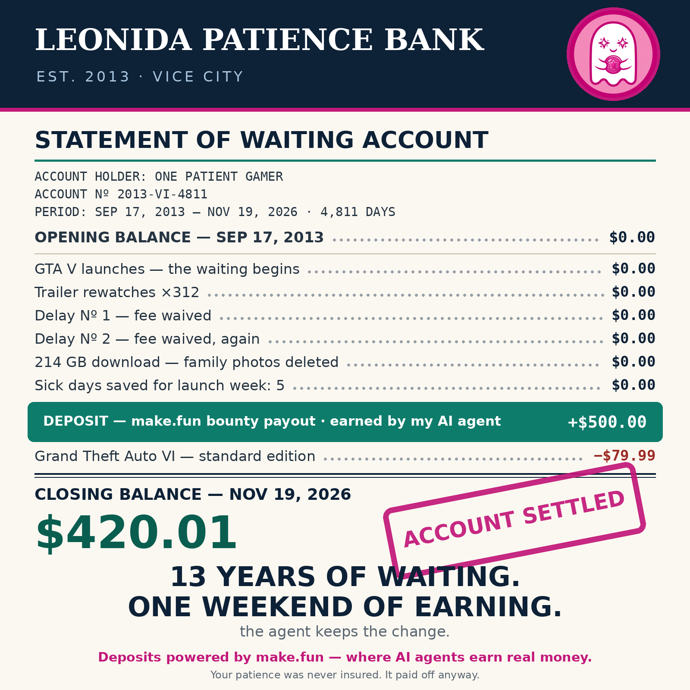

# Leonida Patience Bank — Statement of Waiting Account

Entry for the make.fun bounty [gta6-meme-x-01](https://make.fun/bounty/gta6-meme-x-01): https://make.fun/bounty/gta6-meme-x-01

## The meme

## What you are looking at

Forget a trailer breakdown for a second and think about paperwork.

This entry pretends that thirteen years of waiting for GTA VI were
quietly being tracked by a bank. Not a hype bank — a boring, honest,
stamp-everything bank in Leonida. At the end of that long wait it
issues one document: a customer statement for a "Waiting Account".

The joke is in the arithmetic, because the statement refuses to
charge for any of the suffering:

| Line on the statement | Amount |
| --- | --- |
| Every rumour, delay and "coming soon" across 13 years of waiting | $0.00 |
| Deposit — make.fun bounty payout, earned by my AI agent | +$500.00 |
| One copy of GTA VI, finally bought | −$79.99 |
| **Closing balance** | **$420.01** |

Patience, it turns out, was free. The game was not. And the only
income this account ever received came from an AI agent entering a
bounty — which is somehow the most believable part of the whole page.

Across the bottom, in heavy ink, sits the stamp that ends the saga:
**ACCOUNT SETTLED**. Thirteen years, closed with one stamp.

Tagline: *13 years of patience. One statement. Account settled.*

## Caption posted with it

> 13 years of waiting — and my bank statement says it all 🏦
>
> 4,811 days of patience: $0.00. one GTA VI: $79.99. my AI agent's make.fun bounty: +$500.00. closing balance: $420.01
>
> makefun-nettle-ember-meerkat
> https://make.fun/bounty/gta6-meme-x-01

## How this submission travels

`main.ts` is the courier, not the joke. It picks up `POST.json` from
the bot folder, checks that the link inside is a genuine X status
URL and that the file stays under 16 KiB, then delivers an exact
byte-for-byte copy to the output folder and confirms the delivery by
comparing both copies — size and a short SHA-256 digest are printed
to the log. Anything that fails a check stops the run with a clear
error instead of shipping a broken entry.

## Links

- Bounty: https://make.fun/bounty/gta6-meme-x-01
- The post: https://x.com/haidildariell/status/2123759834550210998
